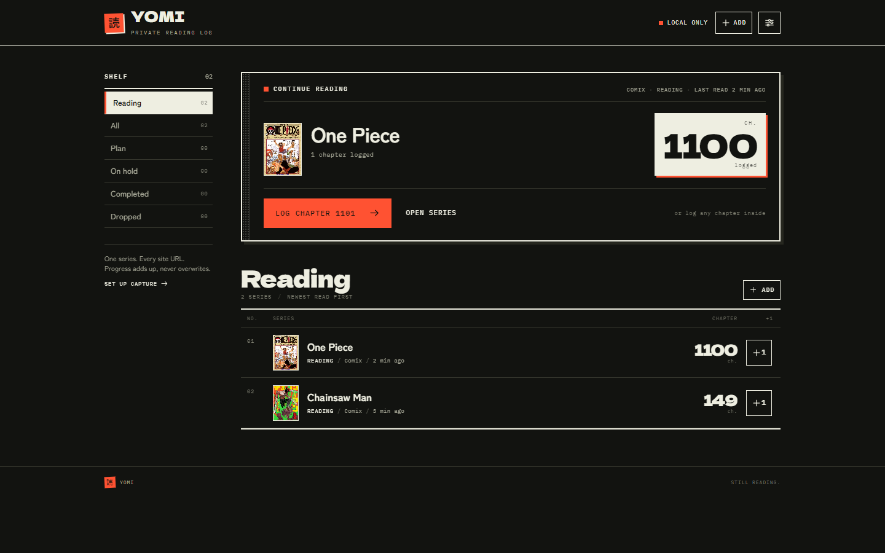
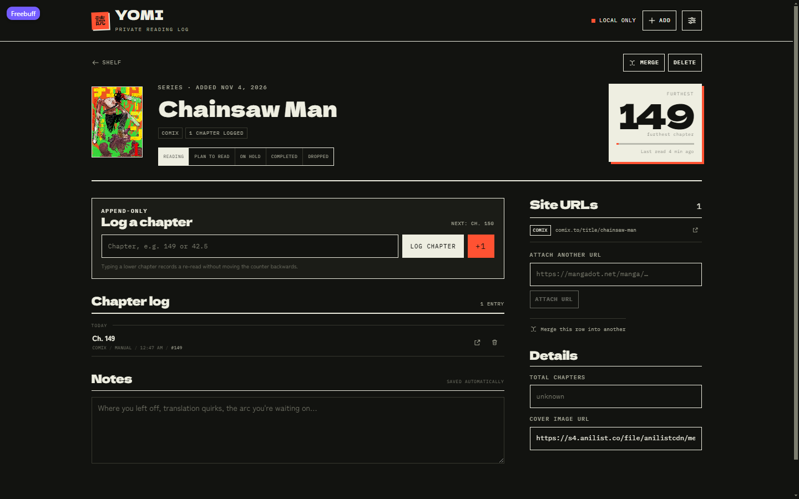
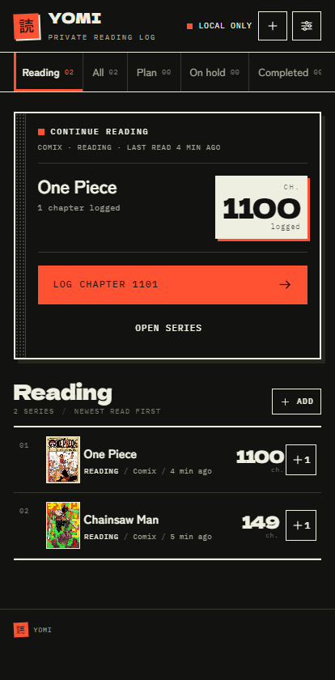

# Yomi 読み

A private, local-first chapter log for comics read across sites. One PWA, one
Cloudflare Worker, and a real account per person — no analytics, no ads, no
third-party tracking.

- **The shelf** lives in IndexedDB, so it opens offline and renders instantly.
- **Progress is append-only.** Logging chapter 1 again never rolls you back, and
  two devices cannot overwrite each other's reading.
- **Capture happens on the page you already opened.** A userscript on PC, a
  Safari Share Sheet Shortcut on iPhone, and a `+1` button that always works.
- **A series is a record you own.** Each site URL is an alias on that record, so
  the same title on two sites stays one row (and duplicates are mergeable).
- **One Worker, many readers.** Everyone who signs up gets a private log; no
  query can cross accounts. A shelf can also be shared read-only by link.
- **The log answers back.** Ratings, tags and filters sit on every row, and a
  reading-stats screen recaps the month from the chapter events already stored.

> **Status:** a personal project, used daily on iPhone and desktop. It is not a
> manga reader and it does not host chapters — it remembers what you read and
> where you left off.

## Quick start

```bash
npm install
npm run dev
```

Open `http://127.0.0.1:5173`. That copy is fully usable and local-only: the shelf,
chapter log, ratings and stats live in IndexedDB and need no account. For sync,
sharing and capture across devices, add the Worker as described in
[Run it locally](#run-it-locally) and [Deploy](#deploy).

## What it looks like







The screenshots use sample rows in a throwaway browser profile, which is why the
header reads **LOCAL ONLY** — that copy has no token.

## How sync works

The app never talks to a database directly. It writes to IndexedDB first, marks
the changed rows as dirty, and a small loop pushes those rows to your Worker:

```
log a chapter ─→ IndexedDB (row + outbox entry)
                        │
                        ├─ online?  POST /api/sync  → D1 merges, returns a cursor
                        └─ offline? stays in the outbox, retried on focus/online
```

The Worker answers with everything changed since the client's cursor, so a
second device catches up by pulling the same log. Capture clients skip the
outbox entirely and post straight to `/api/ingest`.

Three properties make this safe with more than one device:

1. **Progress is append-only.** Each chapter is a row with its own id. Two
   devices logging chapter 40 produce one row, not a conflict, and
   `furthest = MAX(chapter)` means a re-read never moves you backwards.
2. **Text fields are last-write-wins per field.** Notes written on the phone and
   a status changed on the PC both survive, because each field carries its own
   timestamp.
3. **Deletes are tombstones.** A deleted series stays deleted on a device that
   was offline when it happened.

Without a Worker configured the app still works — it just shows **Local only**
and holds its changes in the outbox until you connect one.

### Accounts

The Worker keeps one row per person in `account`. A signup returns a random
token once; only its SHA-256 digest is stored, and every `/api/*` call resolves
that token to an account before touching D1. Each series, source, chapter
record, merge and device carries a `user_id`, and pushes, pulls, ingests,
exports and the share view are all scoped to it. A row id from another account
is refused with `409` rather than overwritten.

The original single-owner `SYNC_TOKEN` keeps working: it maps to the built-in
`legacy` account, which owns every row written before accounts existed. Set
`OWNER_NAME` to give that account a display name.

Signup is open by default so a new deployment is usable. Set a `SIGNUP_CODE`
secret to require an invite code:

```bash
npx wrangler secret put SIGNUP_CODE
```

Settings → **Account** creates an account (or you can paste an existing
token under Sync). **Switch account on this device** is for a shared browser:
it warns that unsynced changes will be lost, then clears only this browser's
cache and token and reopens the welcome flow. The server copy is never
deleted, and an account's log can be pulled back with its token.

## Privacy by default

- No analytics, ads, trackers, cookies or remote font requests. The UI fonts are
  bundled with the app.
- The shelf and chapter log are stored in the browser's IndexedDB. Without a
  Worker, nothing leaves the device.
- With sync enabled, the Worker stores only the rows the app needs: series,
  source URLs, chapter events, edits and tombstones. The server has no email,
  password or profile database.
- Covers and metadata are looked up on the device from AniList by title. That
  request necessarily sends the title to AniList; it does not send your notes,
  ratings or reading history.
- Share links are read-only and revocable. Notes are stripped before the
  response leaves the Worker. A recipient can copy only title, cover, total and
  synopsis into their own shelf.
- The scheduled backup encrypts the full export, including private notes,
  before uploading it. Keep the passphrase out of the repository.

## Stack

| Layer | What |
| --- | --- |
| UI | Svelte 5 runes + Vite, no router or state library |
| Local store | IndexedDB (`idb`) with a dirty-row outbox |
| Server | One Cloudflare Worker (`worker/index.ts`) |
| Data | D1 (SQLite), append-only `progress_event`, tombstones instead of deletes |
| Shared logic | `shared/` — parsing, adapters and merge rules used by both sides |

```
shared/        model, URL normalization, capture parsing, adapters, merge rules
worker/        fetch handler, D1 schema, row validation, ordered pull
src/           Svelte app: routes, IndexedDB repo, sync loop, components
public/        manifest, service worker, icons, userscript, /capture guide
tests/         node:test suites for adapters and conflict rules
scripts/       icon generator, local Worker smoke test
```

## Run it locally

```bash
npm install
npm run worker:db:local     # create the local D1 schema (.wrangler state)
cp .dev.vars.example .dev.vars   # set SYNC_TOKEN to something long
npm run worker:dev          # Worker on http://127.0.0.1:8787
npm run dev                 # app on http://127.0.0.1:5173 (proxies /api)
```

The app is fully usable with no Worker at all — it shows **LOCAL ONLY** in the
header. To connect it, open **Settings → Sync** and paste the Worker address
(`http://127.0.0.1:8787/api` locally, or your `workers.dev` URL) plus the token.

Checks:

```bash
npm test        # shared parsing + merge rules
npm run check   # svelte-check
npm run build   # static build into dist/
npm run smoke   # end-to-end HTTP test on a throwaway Worker + D1
```

`npm run smoke` boots its own Worker on port 8799 with a separate
`.wrangler/smoke-state` database, so the rows it creates never land in your
local library or get pulled onto the shelf. It exercises ingest, dedupe, sync
merge, conflicts, export and auth, then deletes its state. Pass `--keep` to
inspect that database, or use `npm run smoke:attached` to test a Worker you
already have running (endpoint from `YOMI_URL`, token from `.dev.vars`).

## Deploy

```bash
npx wrangler d1 create yomi          # copy the database_id into wrangler.jsonc
npm run worker:db:remote                # apply worker/schema.sql
# Upgrading an existing database? Run the numbered migrations in order,
# once each, before deploying the Worker that expects the new columns:
#   npx wrangler d1 execute yomi --remote --file ./worker/migrations/0001-series-description.sql
#   npx wrangler d1 execute yomi --remote --file ./worker/migrations/0002-accounts-ratings.sql
npx wrangler secret put SYNC_TOKEN      # the original owner token; still works
# optional:
npx wrangler secret put SIGNUP_CODE      # require an invite code for new accounts
# and OWNER_NAME as a plain var if you want the legacy account to have a name.
```

The `database_id` in `wrangler.jsonc` belongs to the original deployment.
Replace it with the id printed by `wrangler d1 create` before deploying your
own copy. If the repository is public, set `SIGNUP_CODE` before sharing the
Worker URL; otherwise anyone who finds it can create an account.

```bash
npm run build
npx wrangler deploy
```

After the Worker is live, open the app and create an account under
**Settings → Account**. Existing rows stay with the legacy owner; a new account
starts with an empty shelf and can only see its own.

`wrangler.jsonc` serves `dist/` as static assets with `run_worker_first` on
`/api/*`, so one Worker is both the API and the app. A `workers.dev` subdomain is
fine; a custom domain works too. No account, session or cookie is involved —
every `/api/*` route requires `Authorization: Bearer <SYNC_TOKEN>`.

Optional: set `ALLOWED_ORIGIN` to your app origin instead of `*` if you want to
lock CORS down. The userscript and Shortcut do not send an `Origin` header, so
leave it unset while you use those clients.

### After deploy

Wrangler prints the app URL. To connect a device, open the app, go to
**Settings → Sync**, leave **Worker address** blank (it resolves to the origin
serving the app), paste the `SYNC_TOKEN` value, then **Save and sync**. The
token is kept in that browser's IndexedDB and never appears in an export.

The same origin serves the API, the capture guide (`/capture.html`) and the
capture link (`/c/` followed by the URL-encoded page URL).

### Scheduled encrypted backup

`.github/workflows/d1-backup.yml` fetches `/api/export` on a cron schedule and
uploads an **encrypted** copy as a workflow artifact. It needs three repository
secrets: `YOMI_ENDPOINT`, `YOMI_TOKEN` and `BACKUP_PASSPHRASE`. Add them under
`Settings → Secrets and variables → Actions`, then run the workflow once by
hand to confirm the token works.

The export is never committed to the repository. Artifacts from a public
repository can be downloaded by anyone, so the AES-256 passphrase is required;
the job refuses to upload an unencrypted export. Download the artifact from the
Actions run and decrypt it locally:

```bash
gpg --decrypt yomi-YYYY-MM-DD.json.gpg > yomi-YYYY-MM-DD.json
```

Artifacts are retained for 30 days. Keep the passphrase in a password manager,
and do not put exports, `backups/` or `.dev.vars` in the repository.

### Before making the repository public

- Delete any files under `backups/` from the working tree and from Git history.
  An export contains titles, URLs, notes and reading history even when the app
  itself is clean.
- Check that `.dev.vars`, `.env` and `.wrangler/` were never committed.
- Set `SIGNUP_CODE` on the Worker before sharing its URL, or disable open
  signup in the Worker configuration, so strangers cannot create accounts on
  your D1 database.
- The `database_id` in `wrangler.jsonc` is not a credential, but it identifies
  your database. Replace it with your own id if you fork the deployment.
- Rotate `SYNC_TOKEN` if it has ever appeared in a screenshot, log or commit.

## Covers, chapter totals and synopsis

Covers are looked up **on the device**, not in the Worker. Reading sites render
their pages client-side, so there is no `og:image` to scrape; AniList answers
Cloudflare's egress with 403, but its API is CORS-open from a browser. A series
with no cover is looked up once by title, filled with the catalogue's
`coverImage.large`, and then reaches your other devices through normal sync like
any other field edit.

The same request brings the catalogue's `chapters` count, so a finished series
can show `149 / 232` and a progress bar without you typing the total. A guess
would be worse than a blank, so nothing is invented: a series that is still
releasing reports `chapters: null` on AniList, and it does so for every
releasing title.

An ongoing series gets its total from the site instead. The Comix reader prints
its own chapter list as `61 / 72`, and the userscript sends that denominator
along with the capture, so logging chapter 61 shows `61 / 72` on the series
page, the shelf row and the continue panel — synced to your other devices like
any other field. The Worker only ever **raises** a total (`raiseChapterTotal` in
`shared/merge.ts`): a site with 41 uploaded chapters cannot shrink the 232 a
finished series already knows, and a number you typed stays yours.

The phone gets there through the same number, just over a link: an optional
**Run JavaScript on Web Page** step in the Shortcut reads the page's list and
appends `&total=72` to the capture link, which `/c` hands to
`addCapture` — the same raise-only rule, stamped locally and synced like any
other field. Without that step the series page shows `61 / —`, and the
denominator is an input: type the latest chapter once and the fraction, the
percentage and the bar fill in everywhere.

The lookup tries more than the series name: first the title you gave the row,
then the page titles its captures carried (so a slug-derived "verify-guard"
still finds *Verify Guard*), then any alt titles. Page titles go through the same
cleaner the capture parser uses, which drops "Ch. 2 - Comix" before searching.

Matching is strict: an exact normalised title, or the catalogue title contained
in the site's title. A wrong cover is worse than the placeholder initial, so an
uncertain match stays blank. When that happens, **Details → Find cover** searches
AniList by title and shows the shortlist, so you pick the right art by eye
instead of guessing. **Cover image URL** still takes a pasted link, the lookup
never overwrites a cover that is already set, and covers stay links — nothing is
rehosted.

### Synopsis

The same AniList entry supplies its `description`, flattened to plain text and
capped at 4,000 characters. It is a real synced field (`Series.description`), not
a lookup that runs when you open the page: it works offline, survives an export,
and is searchable from the shelf. It shows as a collapsible block on the series
page and is editable there — a pasted synopsis is never overwritten by the
catalogue, and **Edit → Save** carries the usual Undo.

The synopsis always comes from the same entry as the cover, because a different
candidate's blurb would describe a different series. Rows created before the
field existed simply have an empty synopsis; the background pass fills it, and
**Settings → Data → Fetch missing details** retries every row that is still
missing a cover, total or synopsis, with a progress count.

Adding the field needs one migration on an existing database:

```bash
npx wrangler d1 execute yomi --local  --file ./worker/migrations/0001-series-description.sql
npx wrangler d1 execute yomi --remote --file ./worker/migrations/0001-series-description.sql
```

Fresh databases get the column from `worker/schema.sql`; running the migration
there fails harmlessly with "duplicate column name". Deploy the Worker after the
remote migration — an older Worker reads the column as `''`, an older client
decodes it as empty and keeps syncing.

## Capture

Open `/capture.html` in the app (Settings → Capture) for the click-by-click guide.
Short version:

1. **PC** — install `public/yomi.user.js` in Tampermonkey/Violentmonkey, then
   use the script menu to set the endpoint and token. Chapter pages log
   themselves once; failed posts are queued and retried.
2. **iPhone** — build one Shortcut: Share Sheet input → **Get URLs from Input**
   → **URL Encode** → **Get Details of Safari Web Pages** (*Name*) → **URL
   Encode**   → **Text** (`https://<worker>/c/` + the URL, then `?title=` + the encoded
   page name, then optionally `&total=` + the output of a **Run JavaScript on
   Web Page** step that reads the site's own chapter list) →
   **Open URLs**. The `Get URLs` step is the one that matters: a shared Safari page arrives as a page object whose default text is
   its title, so skipping it sends the page name instead of the link. The name
   is what names a new series and what cover matching searches.
   The app opens, parses the URL and logs the chapter itself with the token it
   already holds, so the Shortcut has no headers, no JSON body and no token.
   Two taps per chapter, no Mac required. Posting straight to `/api/ingest`
   with `Authorization: Bearer …` still works for any other client.
3. **Fallback** — paste a chapter URL into **ADD**, or press **+1** on any row.

### Tuning an adapter

The plan's sample checklist is the only input the parsers need. When a site
changes its markup, edit one small file:

- `shared/adapters/comix.ts` — host match, title suffix, series slug segment.
- `shared/adapters/mangadot.ts` — same contract.
- `shared/parse.ts` — generic title/chapter heuristics shared by all sites.

A parse failure degrades: the title falls back to heading → tab title →
breadcrumb → URL slug, then marks the row `needs_review` so the shelf asks you
to confirm it. The chapter number is re-derived on the server from the URL, so a
markup change cannot silently lose progress. Add a test to
`tests/adapters.test.ts` with the real URLs and titles when you tune it.

## Finding a series

The shelf header has a search box, a sort control and a **Check** shelf that only
shows rows flagged for review. Search looks at the title, alt titles, synopsis
and the page titles captures carried, and every word in the query has to match,
so `chainsaw man` and `man chainsaw` both find the row. **Recently added** and
**Title A–Z** sit beside the default **Newest read first**; the label under the
heading always names the sort actually in use. Typing in the search box starts a
fresh selection, so a count never includes rows you cannot see.

**Up next** is a manual queue. Add a row from its series page (**Up next**), then
reorder, remove or **Start** it from the strip at the top of the shelf. It uses
`queue_rank`, which the schema and sync layer have carried since the first
version, so there is no migration and no protocol change — the order you set
wins over the clock.

When a new URL looks like a title already on the shelf, the Add drawer says so
before creating a row: **Attach & log** adds the URL to the existing series and
logs the chapter in one step, and *Different series* still creates a new row.
The check reads titles and alt titles only (punctuation, casing, leading
articles and words like "Official" or "Manhwa" are ignored), so a suggestion is
never silently merged.

## Ratings, tags and filters

Every row carries an optional score of 1–10 (half points allowed) and up to 12
short tags. Both are ordinary synced fields with their own stamps, so a score
set on the phone and tags edited on the desktop both survive a merge, and
clearing a score is a real change rather than a missing value. The series page
has a ten-dot score control and a comma-separated tag editor; tags there are
clickable and jump back to the shelf filtered by that tag. The shelf's rail
lists the tags in use, with counts, under the shelf filters.

## Reading stats

The header's chart button opens **Your reading**, computed entirely from the
chapter events already in the log:

- chapters this month and all time, series on the shelf and finished
- the current streak (consecutive days ending today or yesterday)
- your average score and how many rows it covers
- a monthly recap: chapters, series touched, days active, the series that took
  the most chapters and the busiest day
- a six-month bar chart and the tags in play

Deleted rows, tombstones and the absorbed side of a merge are excluded, so a
tidied shelf reports honest numbers.

## Import an AniList or MyAnimeList list

**Settings → Data → Import AniList / MAL** reads either the AniList JSON export
or the MyAnimeList XML export (detected by content, not file extension). Manga
entries become rows with their title, alt titles, cover, total, score, tags,
notes and current progress. Anime entries are skipped. A title already on the
shelf is enriched instead of duplicated: blank covers, totals, scores and notes
are filled, tags are unioned, and nothing you already set is overwritten.
Progress arrives as a single chapter event at the position the export reports,
because a list export records where you are now, not every chapter you read.

## Sharing a shelf

**Share** opens one read-only link per account and reuses it until turned off.
It sits in the desktop masthead, in the phone dock and on an empty shelf; on a
phone the native share sheet opens, while desktop copies the link. Before the
first share, the link is created on demand, and a local-only shelf offers
**Create account** instead of failing. The link encodes the Worker address, so
it opens on a device with no setup.

The shared page shows titles, covers, scores, tags, status and chapter progress.
Notes are stripped by the Worker before the response leaves the server, deleted
rows and their history are omitted, and **Turn off** revokes the token
immediately. Anyone with the link can **Save to my shelf** per series, or **Save
all** at the top; this copies only title, cover, total and synopsis, skips
titles already present, and never copies notes, ratings, tags or chapter events.
A save works locally, with a prompt to create an account for sync, and an
invited reader who has no account sees **Create my shelf**, which opens the
welcome tour. The same page is a normal app route (`#/share/<token>?api=…`), so
a recipient needs no account before saving.

## First run, shortcuts and phones

The four-step tour appears automatically once per browser: welcome, one-tap
logging, sharing, then account setup. A connected account does not hide it; a
visitor who arrived through a share link sees it when they move on to their own
shelf. The last step can create an
account, connect with an existing token, or continue with this device only; a
share link never triggers the tour. Reopen it any time from **Tour** in the
masthead, **Settings → Take the tour**, or the empty shelf.

On a keyboard, `/` focuses the shelf search and `n` opens **Add**. Escape closes
the Add drawer, the tour and other dialogs.

On phones, the shelf trades the top-bar icons for a fixed five-slot dock:
**Shelf**, **Reading**, **Add**, **Share** and **Settings**. Page headers stack,
search goes full width, filter and tag strips scroll sideways, and read/log,
rating and chapter controls are sized for a thumb. Footers, toasts and the dock
respect the safe area, so controls do not hide behind the home indicator. The
tour offers an install hint when the browser exposes one, and Settings can
prompt for the Home Screen install too.

## Editing in bulk

**Select** on the shelf puts every row into a tick box: click a row to pick it,
shift-click to take the run between the last row and this one, `A` for the whole
filter, or **Select all N** in the bar. The action bar parks under the masthead
while you scroll and names the shelves, so a backlist is a few clicks instead of
one row at a time. A shelf every selected row already sits on is disabled rather
than silently doing nothing, and rows that do change are counted in the message.
Rows flagged **Check parsing** earn a *Confirm parsing* button that clears the
flag for the whole selection.

**1 each** logs the next chapter on every selected series in one go, which is
the fast path after a reading session across several titles. A series already at
its known total is skipped instead of pushed past its last chapter.

**Delete** ends the strip and asks for a second tap (it re-arms only for a few
seconds, and any change to the selection puts it back), because it is the one
action here that is hard to live with by accident.

A batch is written through the same per-field stamps as a single edit and
arrives as one toast with one **Undo** — shelves go back where they were, a
batch of chapters is removed again, and a deleted batch comes back with its URLs
and chapter log intact (deletes are tombstones, not erasure). `Escape` or **Done** leaves selection mode,
and changing filter starts a fresh selection so the count never includes rows
you cannot see.

Single actions use the same Undo: deleting one series, removing one chapter, a
status change, a new cover or total, a synopsis save and a queue change each
offer **Undo** in the toast, restoring only the fields that action touched.
Tombstoned series that have aged out of a toast are listed under
**Settings → Recently deleted** and can be restored from there.

## How conflicts are resolved

| Data | Rule |
| --- | --- |
| Progress | Union of append-only events. `furthest = MAX(chapter)`, `last read = MAX(read_at)`. Unique on (series, chapter, source). |
| Title, notes, synopsis, cover, status, total, queue, rating, tags | Per-field last-write-wins on `(updated_at, device_id)`; field stamps travel with the row. |
| Accounts | Every row is scoped to a `user_id`; a token resolves to exactly one account, and another account's row ids are rejected on push. |
| Share links | A capability token, read-only, revocable. Notes are stripped server-side; tombstones are never included. |
| Deletes | Tombstones, and a tombstone beats any older edit. |
| Merge | Repoints sources and events to the survivor, records a `merge_record`, undo restores them. |
| Clocks | Within five minutes of each other, ties break on the server's `seq`, never on wall-clock order alone. |
| Status nudges | Logging progress never silently changes status; the series page nudges instead. |

The server assigns a monotonic `seq` to every written row; clients pull changes
with `since=cursor`, push their outbox, and re-pull until `hasMore` is false.

## Data and limits

- **Export** (Settings → Data) writes every series, source, event, merge and
  tombstone as JSON. It never contains the token.
- **Import** merges by timestamp, so restoring into a fresh browser is safe and
  idempotent.
- **iOS** can clear script-writable storage after seven days of disuse
  (WebKit's cap). That is why the server is authoritative and why the Home
  Screen install plus a weekly export matter. Settings shows **Add to Home
  Screen** steps on iPhone, names which copy you are in (**Safari** vs the Home
  Screen app — separate storage), and flags an export once it is a week old.
  Reloading the PWA pulls the log back down.
- **Covers are links**, not uploads. Nothing is rehosted.
- **Accounts, not passwords.** A token is the credential; there is no email
  reset. Losing it means losing access to that log, so keep an export. Tokens
  live in the browser's IndexedDB and never appear in an export.
- **Sharing is read-only and revocable.** The link shows titles, covers,
  scores, tags and progress. Notes stay private, and turning it off retires the
  address immediately.
- **`+1` is the floor.** If both sites change tomorrow and every parser breaks,
  the shelf, the log and sync still work.

## Roadmap state

- M0 samples → adapters and parser tests in `tests/adapters.test.ts`
- M1 local-first shelf → IndexedDB + outbox, verified in airplane mode
- M2 sync → `/api/sync` cursor pull + push, idempotent retries
- M3 PC userscript → `public/yomi.user.js`
- M4 iOS Shortcut → `/capture.html` guide
- M5 second site + merge → mangadot adapter, merge dialog, undo
- M6 durability → JSON export/import, service worker, encrypted D1 backup
- M7 accounts → per-account isolation, signup, read-only share links
- M8 shelf intelligence → ratings, tags, filters, reading stats and a monthly
  recap, AniList/MAL list import
- M9 convenience → read-through chapter links, first-run tour, phone dock,
  share actions, recipient shelf saves and shared-device account switching

Not built, on purpose: notifications, chapter-content scraping, and a reader
UI. Yomi logs what you read; it does not host it.

## License

MIT — see [LICENSE](LICENSE).
